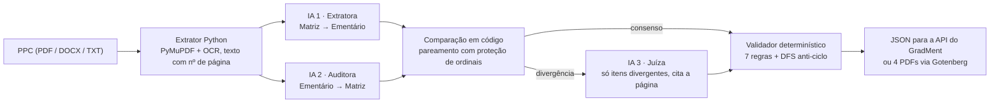
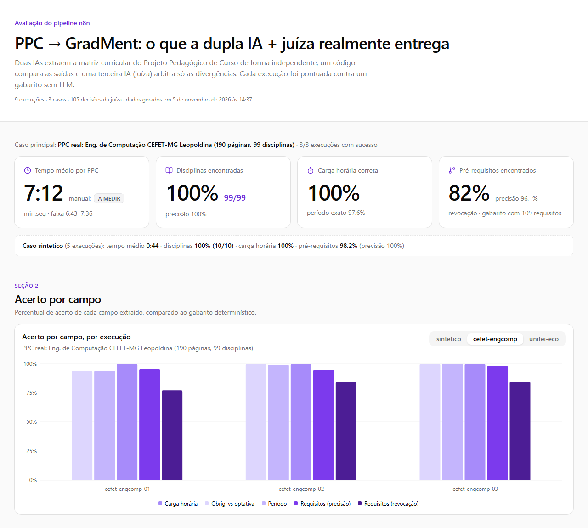
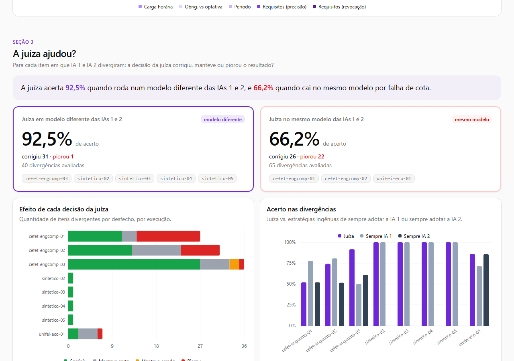

# PPC → GradMent: duas IAs que leem, uma juíza que desempata

> Automação em **n8n** que orquestra **três LLMs de provedores diferentes** para transformar o Projeto Pedagógico de Curso (PPC) de qualquer universidade na matriz curricular que o GradMent importa. Tudo foi **medido contra um gabarito**, inclusive o que deu errado.

## Competências demonstradas

| Competência | Como aparece aqui |
| --- | --- |
| **Automação com n8n** | Workflow de 42 nós com formulário web e API REST. Os Code nodes ficam em arquivos testáveis e o JSON do workflow é gerado por script. |
| **Orquestração de múltiplos LLMs** | Extratora, auditora e juíza em provedores diferentes (Gemini, OpenRouter, Groq), com fallback automático. A juíza só é acionada quando há divergência. |
| **Prompt engineering** | Métodos de leitura opostos para gerar diversidade, JSON Schema estrito, defesa contra *prompt injection* e decisões com a página do PPC citada como evidência. |
| **API sem backend próprio** | `POST /webhook/converter-ppc` devolve o JSON pronto para o endpoint do GradMent, sem mudar uma linha do backend PHP. |
| **Análise de dados com IA** | Gabarito sem LLM, precisão e revocação por campo, auditoria de cada decisão da juíza e o dashboard de resultados. |

---

## Problema

Sou PM do **GradMent**, um planejador de grade curricular que avisa o aluno quando uma reprovação vai atrasar a formatura. Para funcionar, ele precisa da matriz do curso: disciplinas, períodos, carga horária e pré-requisitos. Hoje o GradMent só importa PPCs que seguem o layout do CEFET-MG. **Para levar o produto a qualquer outra universidade, alguém precisa digitar à mão cerca de 100 disciplinas e mais de 100 requisitos**, lidos de um PDF de 150 a 300 páginas.

## Para quem

Coordenações de curso e a equipe do GradMent que cadastra cursos novos.

## O que construí

Um pipeline que recebe o PPC (PDF digital ou escaneado, DOCX ou TXT) e devolve:
1. o **JSON canônico** do GradMent, validado nas 7 regras de negócio do sistema; ou
2. os **4 PDFs** no formato que o parser PHP existente já lê;

junto com um **relatório de auditoria** que mostra o que cada IA disse, onde discordaram e o que a juíza decidiu, com a página do PPC citada.

## Como funciona

- **LLM onde há ambiguidade, código onde há regra:** ler um PPC é ambíguo. Comparar duas listas e validar regras de negócio não é, então essas etapas são código testado.
- **Custo zero:** só cotas gratuitas (Gemini, OpenRouter `:free`, Groq), com fallback entre elas.

## Prompts e decisões

- Prompts: [prompts/](prompts/) (IA 1, IA 2, juíza e os JSON Schemas).
- **Duas leituras opostas** (matriz → ementário e ementário → matriz), para que os erros das IAs não coincidam.
- **Comparação em código**, com proteção de ordinais (Cálculo I nunca vira Cálculo II) e unificação de códigos antes de comparar o grafo de requisitos.
- **Juíza com escopo restrito:** recebe só as divergências e a base de consenso, e cita a página do PPC em cada decisão.
- **Regras de negócio garantidas por código:** o prompt pede, e o validador garante (DFS anti-ciclo, proibição de obrigatória → optativa, códigos válidos).
- **PPC tratado como dado:** defesa contra *prompt injection*, chaves só em variáveis de ambiente, nenhum payload salvo no n8n.

## Resultados (medidos)

9 execuções reais em 05/11/2026 (3 PPCs), pontuadas contra um gabarito gerado **sem LLM** a partir do próprio PPC. Detalhes, metodologia e cada decisão da juíza: [avaliacao/RESULTADOS.md](avaliacao/RESULTADOS.md).

| | PPC real CEFET-MG (190 p., 3 execuções) | PPC real UNIFEI (outro layout, 1 execução) | PPC sintético (5 execuções) |
| --- | ---: | ---: | ---: |
| Tempo da máquina por PPC | **7 min 12 s** | **6 min 21 s** | 44 s |
| Disciplinas encontradas | **100%** (99/99) | **98,6%** (73/74) | 100% |
| Carga horária correta | **100%** | 100% | 100% |
| Período correto | 97,6% | 98,6% | 100% |
| Pré/correquisitos: precisão / revocação | **96,1% / 82,0%** | sem gabarito | 100% / 98,2% |
| Saída válida nas 7 regras do GradMent | 3/3 | 1/1 | 5/5 |

**Contra o processo anterior** (mandar o PPC para um LLM no chat), no mesmo PPC real e com o mesmo gabarito:

| | Um modelo só, PPC inteiro, sem validação | Este pipeline |
| --- | ---: | ---: |
| Obrigatória × optativa correta | 57,1% (as 42 optativas viraram obrigatórias) | **98,0%** |
| Carga horária correta | 43,9% (54 disciplinas em horas-relógio) | **100%** |
| Disciplinas que não existem | 6 | **0** |
| Pré/correquisitos: precisão / revocação | 81,9% / **87,2%** | **96,1%** / 82,0% |
| Aceito pelo GradMent | **não** (código duplicado e ciclos) | **sim** |
| Custo por PPC no Claude Opus 5.5 (PDF anexado; tokens contados pela API) | **US$ 3,08** (520.738 tokens de entrada + 49.905 de saída) | **US$ 0** (cotas gratuitas) |

**A juíza valeu a pena?** Depende de ela ser um modelo diferente das outras duas IAs:

| Juíza | Corrigiu | Piorou | Acerto nas divergências |
| --- | ---: | ---: | ---: |
| Em modelo **diferente** (GPT-OSS / Gemini) | 31 | **1** | **92,5%** |
| No **mesmo** modelo (fallback por cota) | 26 | 22 | 66,2% |

**O que a medição me ensinou:**
1. **Duas IAs concordando não quer dizer que estão certas.** Quando a cota do Gemini caiu, o fallback colocou as duas IAs no mesmo modelo, elas erraram igual e o erro passou direto.
2. **A juíza é boa quando tem diversidade e evidência.** Em modelo diferente, ela corrigiu 31 itens e piorou 1. No mesmo modelo e sem as páginas certas, chegou a piorar mais do que corrigir.
3. **O corte de contexto foi a causa raiz dos piores erros.** As 10 disciplinas cujas páginas foram cortadas do texto são exatamente as que viraram problema.
4. **O ganho não está no relógio, e sim no retrabalho e no custo.** Um modelo só leva um tempo parecido (5,5 min contra 7,2 min), mas entrega uma saída que o GradMent rejeita e custa US$ 3,08 por PPC no Claude Opus. O pipeline entrega o JSON validado, de graça.
5. **O próprio PPC tem inconsistências** (período diferente entre matriz e ficha, código repetido). Um gabarito honesto precisa registrar essas inconsistências em vez de culpar a IA.

## Demo

- **Dashboard dos resultados (feito no v0):** [gradment.vercel.app](https://gradment.vercel.app). Ele lê `avaliacao/dashboard-dados.json` direto deste repositório.
- Vídeo de até 2 min: **[a gravar]**
- Rodar localmente: [docs/guia-tecnico.md](docs/guia-tecnico.md) (`sh scripts/implantar.sh` e depois `http://localhost:5680/form/ppc-gradment`).

## O que eu faria a seguir

1. Exigir diversidade de modelo (principalmente na juíza) e sinalizar no relatório quando o fallback a quebrar.
2. Travar na juíza os campos em que as duas IAs concordam. Ela decide só o que divergiu.
3. Não mandar à juíza divergências apenas de texto de ementa.
4. Cortar o PPC em bloco contíguo, sem escolher páginas soltas.
5. Na dúvida, incluir o requisito e sinalizar (a juíza acerta só 42% das exclusões).
6. Cronometrar o tempo de correção da saída no processo anterior e o tempo de revisão da saída do pipeline (hoje `[A MEDIR]`).

---

Construído com assistência de IA (Claude Code). Os dados do repositório são um PPC sintético e trechos estruturados de PPCs públicos. Não há dado pessoal de alunos.
