# Guia técnico: PPC → GradMent com Dupla IA + Juíza (n8n)

Automação em **n8n** para converter o **Projeto Pedagógico de Curso (PPC)** de qualquer universidade (PDF digital/escaneado, DOCX ou TXT) para os formatos **100% compatíveis** com o backend do **GradMent**:

1. **Caminho A — JSON Canônico Direto (`POST /curriculo/importar/confirmar`):** Payload estruturado validado contra todas as **7 Regras de Ouro** do GradMent.
2. **Caminho B — Os 4 PDFs Canônicos (`POST /curriculo/importar/preview`):** Geração determinística via Gotenberg de `ppc_pdf`, `ementas_pdf`, `turmas_componente_pdf` e `turmas_ofertadas_pdf` com texto selecionável sem quebras de linha acidentais, compatível com as Expressões Regulares de `Smalot\PdfParser` no PHP.

---

## Arquitetura do Pipeline no n8n (42 nós)

```mermaid
flowchart LR
    E["PPC (PDF / DOCX / TXT)"] --> X["Extrator Python (PyMuPDF + OCR + Tabelas DOCX)"]
    X --> P["Preparar Requisições Multi-Provedor"]
    P --> IA1["IA 1: Extratora Top-Down (Matriz → Ementário)"]
    P --> IA2["IA 2: Auditora Bottom-Up (Ementário → Matriz)"]
    IA1 --> M["Merge + Pareamento Semântico Ordinal-Safe"]
    IA2 --> M
    M --> D{"Houve Divergência?"}
    D -- "Não (Consenso)" --> V["Validador Determinístico GradMent (7 Regras + Anti-Ciclo DFS)"]
    D -- "Sim" --> IA3["IA 3: Juíza de Desempate (Evidência de Página no PPC)"]
    IA3 --> V
    V --> B{"Gerar 4 PDFs?"}
    B -- "Sim" --> G["Gotenberg (4 PDFs Canônicos em Paralelo)"]
    B -- "Não" --> R["Dashboard HTML / API JSON + Auditoria"]
    G --> R
```



### Por que o pareamento não gera falsos-positivos?
- Quando um PPC não traz códigos internos ou traz códigos com pontuação (`DCC-101`, `TCC`), duas IAs podem batizar o código interno de formas diferentes (`TCC01` vs `TCCG1`) mesmo concordando em 100% dos dados.
- O nó **`Comparar IAs e Detectar Divergências`** pareia disciplinas por `codigo_externo` normalizado e nome canônico com **proteção estrita de ordinais** (`Cálculo I` jamais é fundido com `Cálculo II`), unifica os códigos antes de comparar o grafo `PRE`/`CO`, e só aciona a **3ª IA (Juíza)** quando há divergência real (disciplina exclusiva, `periodo` / obrigatória vs. optativa, `carga_horaria`, `ementa` ou aresta `PRE`/`CO`).
- Quando acionada, a **3ª IA** arbitra apenas os itens divergentes citando a página do PPC, preservando intacta a base de consenso.

---

## Configuração Multi-Provedor 100% Gratuita (`.env`)

Por padrão, o sistema opera em **custo zero** distribuído em 3 provedores distintos com cotas gratuitas ativas (sem necessidade de cartão de crédito):

```env
GEMINI_API_KEY=sua_chave_aqui
OPENROUTER_API_KEY=sua_chave_aqui
GROQ_API_KEY=sua_chave_aqui
MISTRAL_API_KEY=opcional_backup_gratuito

# Configuração de cada papel (gemini | openrouter | groq | mistral | openai | anthropic)
IA1_PROVIDER=gemini
IA1_MODEL=gemini-3.5-flash-lite

IA2_PROVIDER=openrouter
IA2_MODEL=nvidia/nemotron-3.5-super-vl:free

IA3_PROVIDER=groq
IA3_MODEL=openai/gpt-oss-120b
```

Para validar rapidamente a conectividade e as cotas gratuitas sem consumir tokens de um PPC inteiro:

```bash
node scripts/testar-conectividade-ias.mjs todas
```

> **Fallback inteligente e Modo Demonstração:** Se apenas uma chave global estiver preenchida (ex.: somente `GEMINI_API_KEY`), os slots sem chave fazem fallback automático para o provedor disponível. Se nenhuma chave estiver configurada, o sistema opera em **Modo Demonstração**, permitindo testar tanto o caminho de **Consenso Direto** quanto o caminho de **Divergência + Desempate na 3ª IA**.

---

## Como Executar

```bash
cd ppc-gradment-ia   # raiz do repositório
cp .env.example .env
# Gere N8N_ENCRYPTION_KEY no .env e rode:
sh scripts/implantar.sh
```

- **Formulário Web Interativo:** `http://localhost:5680/form/ppc-gradment`
- **Editor Visual do n8n:** `http://localhost:5680`
- **Endpoint API REST (`Webhook`):** `POST http://localhost:5680/webhook/converter-ppc`

### Exemplo de chamada via API REST

```bash
curl -X POST http://localhost:5680/webhook/converter-ppc \
  -F "ppc=@samples/ppc-ciencia-computacao.pdf" \
  -F "curso_id=1" \
  -F "ano_periodo=2026.1" \
  -F "gerar_pdfs=true"
```

---

## Como Rodar os Testes Automatizados

```bash
# 1. Regerar o JSON do workflow a partir de n8n/codigo/*.js
node n8n/montar-workflow.mjs

# 2. Testes JavaScript (consenso, divergência + 3ª IA, 7 regras GradMent, DFS anti-ciclo e regexes PHP)
node --test tests/*.test.mjs

# 3. Testes Python do serviço de extração (PDF multipágina, DOCX com tabelas e TXT)
python -m pytest services/extrator/tests/test_extrator.py
```

---

## Estrutura do Projeto

| Caminho | Descrição |
| :--- | :--- |
| `prompts/` | System prompts (`ia1`, `ia2`, `ia3`) e JSON Schemas estritos |
| `n8n/codigo/` | Código modular e testável dos Code nodes + biblioteca `_compartilhado.js` |
| `n8n/montar-workflow.mjs` | Construtor determinístico que gera `workflows/ppc-gradment.json` |
| `workflows/ppc-gradment.json` | Workflow completo pronto para importar no n8n |
| `services/extrator/` | Microsserviço Python (`PyMuPDF` + `Tesseract OCR` + leitor de tabelas `DOCX`) |
| `samples/` | PPC sintético completo (`.txt` e `.pdf`) para validação imediata |
| `tests/` | Suíte automatizada de regressão das invariantes e regexes do GradMent |

